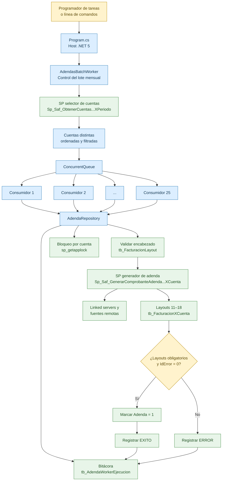

# Worker mensual para generación de adendas

**Tecnología:** .NET 5 / C# / SQL Server  
**Tipo de ejecución:** proceso batch, una ejecución por periodo mensual  
**Paralelismo máximo:** 25 cuentas simultáneas  
**Base operativa:** `PlataformaPlus`  
**Última actualización del documento:** 29/10/2026

## 1. Arquitectura del worker

El worker es una solución independiente de `PlataformaPlus_V5x`. Su función es coordinar la generación mensual de adendas sin modificar las fórmulas ni las reglas contenidas en los procedimientos almacenados existentes.

### Diagrama de arquitectura



> El diagrama requiere que Confluence tenga habilitado Mermaid o un complemento compatible. El diagrama de texto siguiente conserva la misma información cuando Mermaid no está disponible.

```text
Programador / línea de comandos
              |
              v
       Program.cs (.NET Host)
              |
              v
   AdendasBatchWorker
   - valida configuración
   - obtiene cuentas del periodo
   - crea hasta 25 consumidores
              |
              v
     ConcurrentQueue<string>
        |   |   |   ...   |
       01  02  03        25     ejecuciones asíncronas
        \   |   |        /
              v
       AdendaRepository
   - bitácora por ejecución
   - bloqueo lógico por cuenta
   - validación de encabezado
   - validación de duplicados
   - llamada al SP de adenda
   - validación de layouts
              |
              v
 SQL Server / PlataformaPlus
   - SP selector de cuentas
   - SP generador de adenda
   - tb_FacturacionLayout
   - tb_FacturacionXCuenta
   - tb_AdendaWorkerEjecucion
              |
              v
 Linked servers y bases consultadas
 internamente por los SP
```

### 1.1 Componentes de aplicación

| Componente | Responsabilidad |
|---|---|
| `Program.cs` | Inicializa el host .NET, carga configuración y registra dependencias. La precedencia es: argumentos de línea de comandos, variables de entorno, `appsettings.Local.json` y `appsettings.json`. |
| `AdendasOptions.cs` | Define y valida año, mes, paralelismo, límites, tiempos de espera y nombres de procedimientos. |
| `AdendasBatchWorker.cs` | Controla el lote completo, obtiene las cuentas, crea la cola concurrente, inicia hasta 25 consumidores y consolida los resultados. |
| `AdendaRepository.cs` | Encapsula las operaciones SQL, bitácora, bloqueos por cuenta, validaciones de datos, ejecución del SP y actualización final del encabezado. |
| `RunState` | Conserva el código de salida del proceso: `0`, `1` o `2`. |

### 1.2 Flujo de ejecución

1. Valida que el año, mes, conexión, paralelismo y nombres de SP sean válidos.
2. Confirma la existencia de `tb_AdendaWorkerEjecucion`, `tb_FacturacionLayout` y `tb_FacturacionXCuenta`.
3. Ejecuta `Sp_Saf_ObtenerCuentasComprobanteFiscalFacturacionXPeriodo` con `TipoGeneracion = 'F'`.
4. Lee la primera columna del resultado, elimina cuentas duplicadas, ordena las cuentas y aplica `MaxCuentas` cuando el valor es mayor que cero.
5. Carga las cuentas en una `ConcurrentQueue<string>`.
6. Inicia como máximo 25 consumidores asíncronos. Cada consumidor toma una cuenta cuando queda disponible.
7. Para cada cuenta:
   1. Crea una fila de bitácora con estado `EN_PROCESO`.
   2. Obtiene un bloqueo exclusivo mediante `sp_getapplock`, usando año, mes y cuenta como llave.
   3. Busca exactamente un encabezado `CUENTAS` en `tb_FacturacionLayout`.
   4. Verifica que no existan layouts 11–18 previos o inconsistentes.
   5. Ejecuta `Sp_Saf_GenerarComprobanteAdendaFacturacionXCuenta`.
   6. Verifica `@IdError` y los layouts obligatorios 11–15 y 17–18. El layout 16 puede ser opcional.
   7. Si la validación es correcta, actualiza `tb_FacturacionLayout.Adenda = 1`.
   8. Finaliza la bitácora con resultado, tiempos, filas generadas y mensaje.
   9. Libera el bloqueo lógico de la cuenta.
8. Consolida éxitos, omisiones y errores; después termina el proceso.

### 1.3 Modelo de concurrencia

- `MaxParalelismo = 25` significa hasta 25 llamadas activas al mismo tiempo.
- Cada cuenta utiliza su propia conexión SQL.
- La asincronía no crea 25 hilos ocupados permanentemente. Mientras SQL procesa una solicitud, el hilo de .NET puede atender otras continuaciones.
- El pool de conexiones está configurado con un máximo de 100 conexiones, suficiente para las 25 ejecuciones y las operaciones auxiliares de bitácora.
- `Task.WhenAll` espera a que terminen todos los consumidores del lote.
- `Interlocked.Increment` actualiza de manera segura los contadores compartidos.
- `sp_getapplock` evita que dos instancias de este worker procesen simultáneamente la misma combinación de año, mes y cuenta.
- El bloqueo no coordina automáticamente ejecuciones iniciadas por otros sistemas que no utilicen la misma llave de `sp_getapplock`.

### 1.4 Configuración

| Propiedad | Descripción | Valor predeterminado |
|---|---|---:|
| `ConnectionStrings:PlataformaPlus` | Conexión a la base donde residen los SP y tablas de facturación. | LocalDB de ejemplo |
| `Adendas:Anio` | Año que se procesará. | `0`; debe configurarse |
| `Adendas:Mes` | Mes que se procesará, de 1 a 12. | `0`; debe configurarse |
| `Adendas:IdEmisor` | Identificador enviado al SP selector de cuentas. | `1` |
| `Adendas:TipoGeneracion` | Tipo requerido por el selector de cuentas. | `F` |
| `Adendas:MaxParalelismo` | Número máximo de cuentas en proceso simultáneo. | `25` |
| `Adendas:MaxCuentas` | Límite opcional de cuentas; `0` procesa todas. | `0` |
| `Adendas:TimeoutSegundos` | Tiempo máximo de una llamada al SP de adenda. | `10800` segundos |
| `Adendas:TimeoutCuentasSegundos` | Tiempo máximo del SP selector de cuentas. | `3600` segundos |
| `Adendas:ProcedimientoCuentas` | Nombre del SP que devuelve las cuentas del periodo. | `dbo.Sp_Saf_ObtenerCuentasComprobanteFiscalFacturacionXPeriodo` |
| `Adendas:ProcedimientoAdenda` | Nombre del SP que genera los layouts de una cuenta. | `dbo.Sp_Saf_GenerarComprobanteAdendaFacturacionXCuenta` |

## 2. ¿Qué resuelve?

El worker resuelve la orquestación masiva de adendas por periodo mensual:

- Evita ejecutar manualmente el SP cuenta por cuenta.
- Procesa hasta 25 cuentas simultáneamente, manteniendo el cálculo dentro del SP existente.
- Separa la coordinación en C# de las reglas de negocio que permanecen en SQL.
- Registra una trazabilidad individual por cuenta y una llave común de lote.
- Mide por separado la duración total de la cuenta y la duración exclusiva del SP.
- Detecta cuentas sin encabezado, encabezados duplicados, layouts previos y datos parciales.
- Evita duplicar adendas que ya fueron generadas correctamente.
- Verifica que se hayan producido los layouts obligatorios antes de marcar la adenda como terminada.
- Permite limitar cuentas para pruebas controladas mediante `MaxCuentas`.
- Devuelve códigos de salida utilizables por un programador de tareas o herramienta de monitoreo.

El worker no recalcula saldos ni reemplaza la lógica interna del SP. Tampoco crea encabezados faltantes, elimina datos parciales o reintenta automáticamente cuentas con error.

## 3. Comparativa: procesamiento SQL vs. asincronía en C#

La comparación aplicable es entre un procedimiento masivo que recorre cuentas de manera secuencial y un coordinador C# que ejecuta el mismo SP individual con concurrencia controlada.

| Aspecto | Ejecución masiva desde SQL | Worker asíncrono en C# |
|---|---|---|
| Unidad de trabajo | Normalmente un cursor o ciclo dentro de un SP masivo. | Una cuenta independiente por tarea lógica. |
| Concurrencia entre cuentas | Un cursor es secuencial. El paralelismo interno de SQL no equivale a invocar 25 veces un SP de negocio. | Hasta 25 llamadas simultáneas configurables. |
| Uso de conexiones | Una sesión puede concentrar todo el lote. | Una conexión por cuenta activa, administrada por el pool. |
| Aprovechamiento de espera de I/O | La sesión espera consultas locales o linked servers antes de continuar con la siguiente cuenta. | Mientras unas llamadas esperan SQL o red, otras cuentas pueden avanzar. |
| Aislamiento de fallos | Un error puede interrumpir el cursor o requerir manejo especial para continuar. | El error se registra por cuenta y las demás tareas continúan. |
| Trazabilidad | Debe programarse expresamente dentro del SP masivo. | Bitácora uniforme por lote, cuenta, SP, estado y duración. |
| Cancelación | Depende de cancelar la sesión SQL completa. | Usa `CancellationToken` y cierre controlado del host. |
| Control de carga | Generalmente fijo dentro del código SQL. | `MaxParalelismo` permite ajustar la presión sobre SQL y linked servers. |
| Reutilización de reglas | Puede concentrar coordinación y reglas en el mismo SP. | Conserva las reglas en los SP y deja a C# únicamente la coordinación. |
| Riesgo principal | Cursores largos, sesión monolítica y menor observabilidad por cuenta. | Saturar SQL, red, tempdb o linked servers si el paralelismo es mayor que la capacidad real. |

### 3.1 Criterio técnico

Si toda la generación pudiera expresarse como una sola operación SQL por conjuntos, esa alternativa podría ser más eficiente que 208,000 llamadas independientes. Sin embargo, el SP actual trabaja por cuenta, utiliza múltiples reglas y fuentes remotas, y debe conservar resultados existentes. Bajo esa condición, la asincronía en C# permite paralelizar la espera sin reescribir la lógica funcional.

La mejora esperada no proviene de que C# calcule más rápido que SQL. Proviene de mantener ocupadas hasta 25 unidades de trabajo independientes mientras otras esperan respuesta de SQL o de los linked servers.

## 4. Estimación de rendimiento con 25 ejecuciones simultáneas

### 4.1 Fórmula

Para `N` cuentas, paralelismo `P` y duración promedio real `T` por cuenta:

```text
Tandas = techo(N / P)
Tiempo ideal = Tandas × T
Tiempo planeado = Tiempo ideal + degradación y sobrecarga operativa
```

Para 208,000 adendas y paralelismo 25:

```text
Tandas = techo(208,000 / 25)
Tandas = 8,320
```

### 4.2 Resultado de la prueba controlada

La fixture LocalDB utilizó un SP simulado con una espera fija de 2 segundos. Se observaron 25 llamadas simultáneas:

- 30 cuentas seleccionadas.
- 29 llamadas reales al SP.
- 28 resultados exitosos.
- 1 error simulado después de insertar.
- 1 cuenta omitida por falta de encabezado.
- Promedio observado del SP: entre `2.011` y `2.013` segundos.
- Duración del lote con 29 llamadas: entre `4.172` y `4.281` segundos, correspondiente a dos tandas.

Esta prueba valida la concurrencia y la coordinación, pero no reproduce consultas remotas, volumen, bloqueos ni cálculos reales de producción.

### 4.3 Proyección para 208,000 adendas

| Promedio real por adenda | Tiempo secuencial aproximado | Tiempo ideal con 25 | Tiempo con margen de 20% |
|---:|---:|---:|---:|
| 2.013 s, referencia LocalDB | 116.3 h | 4.65 h | 5.58 h |
| 5 s | 288.9 h | 11.56 h | 13.87 h |
| 10 s | 577.8 h | 23.11 h | 27.73 h |
| 15 s | 866.7 h | 34.67 h | 41.60 h |
| 30 s | 1,733.3 h | 69.33 h | 83.20 h, 3.47 días |
| 60 s | 3,466.7 h | 138.67 h | 166.40 h, 6.93 días |

### 4.4 Estimación que puede comunicarse

Con la única medición controlada disponible, el resultado matemático para 208,000 adendas es aproximadamente **4 horas 39 minutos en condiciones ideales**, o **entre 5 horas 7 minutos y 5 horas 35 minutos** agregando un margen de 10% a 20%.

Este valor no debe presentarse como tiempo definitivo de producción porque el SP de la prueba solo esperaba dos segundos. El compromiso operativo debe calcularse con `DuracionSpMs` de una prueba QA representativa. Como referencia:

- Si QA obtiene un promedio cercano a 10 segundos, planear aproximadamente 28 horas.
- Si QA obtiene un promedio cercano a 30 segundos, planear aproximadamente 3.5 días.
- Si al aumentar de 1 a 25 llamadas el promedio individual crece, se debe usar el promedio bajo carga, no el promedio de una ejecución aislada.

### 4.5 Consulta para recalcular la estimación con datos reales

```sql
DECLARE @TotalAdendas bigint = 208000;
DECLARE @Paralelismo int = 25;

;WITH Medicion AS
(
    SELECT AVG(CONVERT(decimal(18,2), DuracionSpMs)) AS PromedioMs
    FROM dbo.tb_AdendaWorkerEjecucion
    WHERE NombreSP = 'dbo.Sp_Saf_GenerarComprobanteAdendaFacturacionXCuenta'
      AND SpInvocado = 1
      AND Estatus = 'EXITO'
      AND DuracionSpMs IS NOT NULL
)
SELECT PromedioMs,
       ((@TotalAdendas + @Paralelismo - 1) / @Paralelismo) AS Tandas,
       CAST(
           (((@TotalAdendas + @Paralelismo - 1) / @Paralelismo) * PromedioMs)
           / 1000.0 / 3600.0
           AS decimal(18,2)
       ) AS HorasIdeales,
       CAST(
           (((@TotalAdendas + @Paralelismo - 1) / @Paralelismo) * PromedioMs * 1.20)
           / 1000.0 / 3600.0
           AS decimal(18,2)
       ) AS HorasConMargen20
FROM Medicion;
```

Para una medición confiable se recomienda probar primero 100, 500 y 1,000 cuentas, revisar CPU, memoria, bloqueos, tempdb, conexiones y consumo de los linked servers, y después confirmar si 25 es el paralelismo sostenible.

## 5. Objetos de base de datos

### 5.1 Resumen

| Objeto | Tipo | Propiedad | Uso |
|---|---|---|---|
| `dbo.tb_AdendaWorkerEjecucion` | Tabla | Creada para el worker | Bitácora de selección de cuentas y ejecución por cuenta. |
| `IX_tb_AdendaWorkerEjecucion_Periodo` | Índice | Creado para el worker | Consultas por año, mes, cuenta y fecha. |
| `IX_tb_AdendaWorkerEjecucion_Lote` | Índice | Creado para el worker | Consultas y consolidación por lote. |
| `dbo.Sp_Saf_ObtenerCuentasComprobanteFiscalFacturacionXPeriodo` | Procedimiento | Existente | Obtiene las cuentas candidatas del periodo. |
| `dbo.Sp_Saf_GenerarComprobanteAdendaFacturacionXCuenta` | Procedimiento | Existente | Genera los layouts 11–18 para una cuenta. |
| `dbo.tb_FacturacionLayout` | Tabla | Existente | Encabezado del estado de cuenta y marca de adenda. |
| `dbo.tb_FacturacionXCuenta` | Tabla | Existente | Almacena cada línea de layout generada. |
| `sys.sp_getapplock` | Procedimiento de sistema | SQL Server | Obtiene bloqueo lógico por cuenta y periodo. |
| `sys.sp_releaseapplock` | Procedimiento de sistema | SQL Server | Libera el bloqueo lógico. |

### 5.2 `dbo.tb_AdendaWorkerEjecucion`

| Campo | Tipo SQL | Nulo | Descripción |
|---|---|---:|---|
| `IdEjecucion` | `bigint IDENTITY(1,1)` | No | Llave primaria de cada registro de bitácora. |
| `IdLote` | `uniqueidentifier` | No | Identificador común para todas las ejecuciones de un arranque del worker. |
| `NumeroCuenta` | `varchar(15)` | Sí | Cuenta procesada. Es `NULL` en la fila correspondiente al SP selector. |
| `Anio` | `int` | No | Año del periodo solicitado. |
| `Mes` | `int` | No | Mes del periodo solicitado. |
| `NombreSP` | `varchar(257)` | No | Procedimiento asociado a la ejecución. |
| `Estatus` | `varchar(20)` | No | Estado: `EN_PROCESO`, `EXITO`, `ERROR`, `OMITIDA` o `CANCELADA`. |
| `FechaInicioUtc` | `datetime2(3)` | No | Inicio total de la operación en UTC. |
| `FechaFinUtc` | `datetime2(3)` | Sí | Fin total de la operación en UTC. |
| `DuracionMs` | `bigint` | Sí | Duración completa: conexión, validaciones, SP y comprobaciones posteriores. |
| `SpInvocado` | `bit` | No | Indica si se alcanzó a invocar el procedimiento de negocio. |
| `FechaInicioSpUtc` | `datetime2(3)` | Sí | Inicio exclusivo de la llamada al SP, en UTC. |
| `FechaFinSpUtc` | `datetime2(3)` | Sí | Fin exclusivo de la llamada al SP, en UTC. |
| `DuracionSpMs` | `bigint` | Sí | Duración exclusiva del procedimiento, en milisegundos. |
| `IdError` | `int` | Sí | Código devuelto mediante `@IdError` por el SP de adenda. |
| `MensajeError` | `nvarchar(1000)` | Sí | Motivo de error, omisión, cancelación o mensaje del SP. |
| `FilasGeneradas` | `int` | Sí | Para el selector: cuentas distintas resultantes. Para la adenda: filas 11–18 encontradas después del SP. |

#### Restricciones e índices

| Objeto | Definición |
|---|---|
| `PK_tb_AdendaWorkerEjecucion` | Llave primaria en `IdEjecucion`. |
| `CK_tb_AdendaWorkerEjecucion_Estatus` | Limita el estado a los cinco valores admitidos. |
| `CK_tb_AdendaWorkerEjecucion_Duracion` | Impide duraciones totales negativas. |
| `CK_tb_AdendaWorkerEjecucion_DuracionSp` | Impide duraciones de SP negativas. |
| `IX_tb_AdendaWorkerEjecucion_Periodo` | `Anio, Mes, NumeroCuenta, FechaInicioUtc`. |
| `IX_tb_AdendaWorkerEjecucion_Lote` | `IdLote, IdEjecucion`. |

### 5.3 `dbo.tb_FacturacionLayout`

El worker no crea esta tabla. La siguiente descripción corresponde al modelo utilizado por PlataformaPlus; las longitudes físicas de los campos de texto deben confirmarse en cada ambiente.

| Campo | Tipo lógico | Uso en el proceso |
|---|---|---|
| `IdFacturacionLayout` | `int` | Identificador del encabezado. |
| `Folio` | `int` | Folio asignado al comprobante o estado de cuenta. |
| `Sistema` | Texto | El worker requiere el valor `CUENTAS`. |
| `NumeroCuentaCredito` | Texto | Cuenta utilizada para cruzar el resultado del SP selector. |
| `Anio` | `int` | Año que debe coincidir con la configuración del lote. |
| `Mes` | `int` | Mes que debe coincidir con la configuración del lote. |
| `UsuarioCreacion` | Texto | Usuario que creó el encabezado. |
| `FechaCreacion` | `datetime` | Fecha de creación del encabezado. |
| `UsuarioModificacion` | Texto | Usuario de la última modificación. |
| `FechaModificacion` | `datetime` | Fecha de la última modificación. |
| `IdEstado` | `int` | Estado operativo del encabezado. |
| `Observacion` | Texto | Observaciones o mensajes asociados al procesamiento. |
| `Facturacion` | Texto | Indicador del estado de facturación. |
| `PDF` | Texto | Indicador del estado de generación de PDF. |
| `FechaGeneracion` | `datetime` | Fecha exacta usada para generar y posteriormente localizar los layouts. |
| `Adenda` | `bit` | `0`: pendiente; `1`: adenda validada como generada. |

Regla del worker: debe existir exactamente un encabezado para `Sistema = 'CUENTAS'`, cuenta, año y mes. Si no existe se registra `OMITIDA`; si existe más de uno se registra `ERROR`.

### 5.4 `dbo.tb_FacturacionXCuenta`

| Campo | Tipo SQL observado en el esquema DEV | Nulo | Descripción |
|---|---|---:|---|
| `IdSecuencia` | `int` | No | Identificador de la fila de layout. |
| `FechaGeneracion` | `datetime` | Sí | Fecha que relaciona el detalle con el encabezado. |
| `Anio` | `int` | No | Año del layout. |
| `Mes` | `int` | No | Mes del layout. |
| `IdOrdenLayout` | `numeric(18,0)` | No | Tipo y orden lógico del layout. Para adendas se utilizan 11–18. |
| `Cuenta` | `varchar(15)` | No | Cuenta propietaria del detalle. |
| `DetalleLayout` | `varchar(max)` | No | Cadena delimitada por `|` con la información generada por el SP. |

### 5.5 Significado de layouts 11–18

| `IdOrdenLayout` | Prefijo | Contenido |
|---:|---|---|
| `11` | `AdendaDatosCliente` | Datos de identificación y domicilio del cliente. |
| `12` | `AdendaEncabezado` | Periodo, fecha de generación e información general del encabezado. |
| `13` | `AdendaDatosCuenta` | Producto, moneda, CLABE, sucursal y características de la cuenta. |
| `14` | `AdendaSaldos` | Saldos, cargos, abonos y desglose del saldo final. |
| `15` | `AdendaMovimientosObjetados` | Reclamaciones o movimientos objetados. |
| `16` | `AdendaMovimientos` | Detalle de movimientos del periodo. Puede no generarse cuando no existen movimientos aplicables. |
| `17` | `AdendaDatosGrafica` | Valores utilizados en la gráfica de saldos o movimientos. |
| `18` | `AdendaUDIS` | Valor de UDIS, equivalente en pesos y fecha de corte. |

El worker exige los siete layouts obligatorios `11, 12, 13, 14, 15, 17 y 18`. El layout 16 se considera opcional.

### 5.6 `dbo.Sp_Saf_ObtenerCuentasComprobanteFiscalFacturacionXPeriodo`

| Parámetro | Tipo | Descripción |
|---|---|---|
| `@IdEmisor` | `int` | Identificador del emisor. El worker envía el valor configurado, normalmente `1`. |
| `@Anio` | `int` | Año del periodo. |
| `@Mes` | `int` | Mes del periodo. |
| `@PeriodoInicio` | `datetime` | Primer día del mes a las 00:00:00. |
| `@PeriodoFinal` | `datetime` | Último día del mes a las 00:00:00. |
| `@TipoGeneracion` | `varchar(1)` | El worker utiliza `F` para cuentas. |

El procedimiento debe devolver la cuenta en la primera columna. El worker acepta cuentas de hasta 15 caracteres, elimina duplicados y las ordena antes de procesarlas.

En la definición exportada de DEV, la rama `F` utiliza `SAF.CC.CC_SALDOS_MES` y `SAF.CC.CC_CUENTA`. Se deben confirmar las dependencias de la definición instalada en cada ambiente.

### 5.7 `dbo.Sp_Saf_GenerarComprobanteAdendaFacturacionXCuenta`

| Parámetro | Tipo | Dirección | Descripción |
|---|---|---|---|
| `@NumeroCuenta` | `varchar(15)` | Entrada | Cuenta que se procesará. |
| `@FechaGeneracion` | `datetime` | Entrada | Fecha tomada del encabezado `tb_FacturacionLayout`. |
| `@PeriodoInicio` | `datetime` | Entrada | Primer día del periodo. |
| `@PeriodoFinal` | `datetime` | Entrada | Último día del periodo. |
| `@Anio` | `int` | Entrada | Año del lote. |
| `@Mes` | `int` | Entrada | Mes del lote. |
| `@IdError` | `int` | Salida | `0` indica que el SP no reportó error; otro valor se registra como `ERROR`. |
| `@MensajeError` | `varchar(500)` | Salida | Mensaje funcional o técnico devuelto por el SP. |

El worker no considera suficiente que `@IdError = 0`: posteriormente comprueba las filas insertadas y la presencia de los layouts obligatorios.

### 5.8 Fuentes remotas utilizadas por el selector de DEV

| Objeto | Campo utilizado | Descripción |
|---|---|---|
| `SAF.CC.CC_SALDOS_MES` | `NUM_CUENTA` | Cuenta candidata. |
| `SAF.CC.CC_SALDOS_MES` | `Cod_Empresa` | Se filtra la empresa `AKALA`. |
| `SAF.CC.CC_SALDOS_MES` | `ANIO_CORTE` | Año del saldo mensual. |
| `SAF.CC.CC_SALDOS_MES` | `MES_CORTE` | Mes del saldo mensual. |
| `SAF.CC.CC_SALDOS_MES` | `IND_ESTADO` | Se admiten estados `A`, `B` y `T`. |
| `SAF.CC.CC_SALDOS_MES` | `SAL_TOTAL_CUENTA` | La cuenta es candidata cuando este saldo o el promedio es positivo. |
| `SAF.CC.CC_SALDOS_MES` | `SAL_PROMEDIO` | Segunda condición de saldo positivo. |
| `SAF.CC.CC_CUENTA` | `NUM_CUENTA` | Confirma que la cuenta exista en el catálogo de cuentas. |

## 6. Estados y códigos de salida

| Estado de cuenta | Significado |
|---|---|
| `EN_PROCESO` | La fila de bitácora se creó y la operación no ha terminado. |
| `EXITO` | El SP terminó sin error y los layouts obligatorios fueron encontrados. |
| `OMITIDA` | No se invocó el SP porque faltó el encabezado o la adenda ya estaba generada correctamente. |
| `ERROR` | Falló una validación, el SP, la conexión o se detectaron datos parciales/inconsistentes. |
| `CANCELADA` | El host recibió una solicitud de cancelación. |

| Código del proceso | Significado |
|---:|---|
| `0` | El lote terminó sin errores. También aplica cuando el selector devuelve cero cuentas. |
| `1` | Existieron errores o se seleccionaron cuentas pero ninguna pudo invocar el SP por falta de encabezados. |
| `2` | El lote fue cancelado por el host. |

## 7. Consideraciones operativas

- Las fechas de la bitácora se almacenan en UTC.
- No se debe incluir `appsettings.Local.json` en repositorios o paquetes porque contiene la conexión real.
- Una reejecución no borra automáticamente información parcial.
- Si existen layouts pero `Adenda = 0`, el worker registra error y exige revisión manual.
- Si el SP insertó datos y posteriormente falló, la cuenta debe revisarse antes de reintentar.
- Antes de procesar 208,000 cuentas se debe validar el comportamiento de SQL Server y de los linked servers con carga gradual.
- .NET 5 se eligió para coincidir con PlataformaPlus V5, pero está fuera de soporte; se recomienda planear su migración a una versión LTS.
